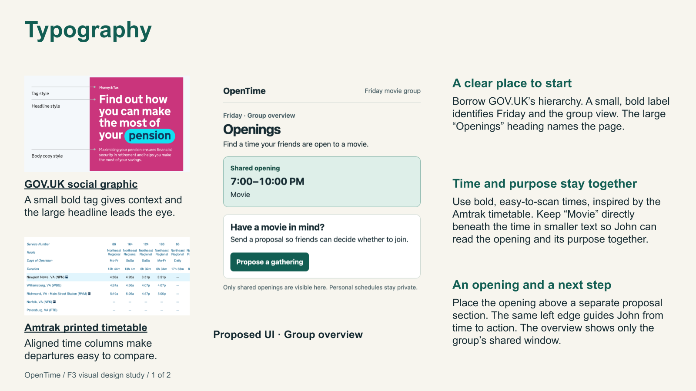
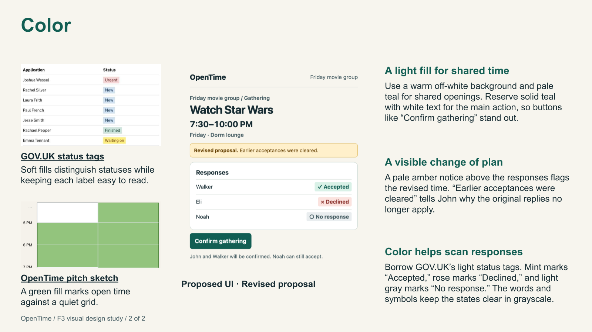

# OpenTime visual design study

The two slides use [John’s Friday movie gathering](core-user-journey.md) to show how OpenTime presents a shared opening and a revised proposal, focusing on typography and color.

## Typography and layout

[GOV.UK social typography](https://brand.design-system.service.gov.uk/typography/social/) · [Amtrak timetable](https://content.amtrak.com/content/timetable/Northeast%20Regional.pdf)

## Color

[GOV.UK status tags](https://design-system.service.gov.uk/components/tag/coloured-tags/) · [OpenTime pitch sketch](https://docs.google.com/presentation/d/18HX2CHjc31JB2Bg-s9xxSwk-Zex411e68c8fTyNOnxk/edit#slide=id.p3)
